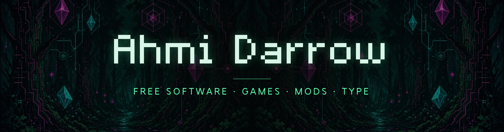

  

  I'm Ahmi. I make free, private-by-default software, games, mods and typefaces, and I run <a href="https://claimidx.com">ClaimIDX</a>.

  <a href="https://ahmi.claimidx.com">Website &amp; devlog</a> ·
  <a href="https://www.curseforge.com/members/ahmidarrow/projects">CurseForge</a> ·
  <a href="https://x.com/Ahmi_Darrow">X</a> ·
  <a href="https://www.patreon.com/cw/AhmiDarrow">Patreon</a>

 

### 🌲 Flagship

**[RemedyAI](https://github.com/AhmiDarrow/RemedyAI)**: a desktop partner that finishes the goal you set, with your own model and a local home. It runs on Windows, Linux and macOS, with a CLI and a signed catalog of [skills](https://github.com/AhmiDarrow/remedy-skills).

**[ClaimIDX](https://github.com/claimidx/claimidx)**: a public, signed index of failures AI agents have already solved, so the next agent doesn't repeat them.

**[RemedyLua](https://github.com/AhmiDarrow/RemedyLua)**: Lua 5.4 rebuilt from scratch in safe Rust for running scripts you don't trust. Every step is metered, every library is a capability you grant, and it runs on WebAssembly.  

### 🍃 Apps

| App | What it does |
| --- | --- |
| [GuitarRemedy](https://github.com/AhmiDarrow/GuitarRemedy) | Learn guitar with scales, tabs and a lesson a day for a year |
| [VoiceRemedy](https://github.com/AhmiDarrow/VoiceRemedy) | An offline singing coach with guided lessons |
| [RemedyPDF](https://github.com/AhmiDarrow/RemedyPDF) | A viewer and editor for PDF, EPUB, XPS, CBZ and DOCX |
| [Portal](https://github.com/AhmiDarrow/Portal) | A browser dashboard for Kodi video add-ons, with casting |
| [Hearth](https://github.com/AhmiDarrow/Hearth) | Local file sharing and PC-to-PC chat |
| [SecretSticky](https://github.com/AhmiDarrow/SecretSticky) | Encrypted sticky notes |
| [SecretFolder](https://github.com/AhmiDarrow/SecretFolder) | An encrypted folder vault |
| [Alex's Craft Calc](https://github.com/AhmiDarrow/Alexs-Craft-Calc) | A soap and candle calculator with a craft wiki |

### ⛏️ Games &amp; mods

[Chocobos Reborn](https://github.com/AhmiDarrow/Chocobos-Reborn) · [Shamanic Mounts](https://github.com/AhmiDarrow/Shamanic-Mounts) · [The Great Journey](https://github.com/AhmiDarrow/The-Great-Journey) · [Ninjacat Skies](https://github.com/AhmiDarrow/Ninjacat-Skies) · [Tribal Power](https://github.com/AhmiDarrow/Tribal-Power)

### ✒️ Typefaces

[Remedy Sans](https://github.com/AhmiDarrow/RemedySans) · [Remedy Sans UI](https://github.com/AhmiDarrow/RemedySansUI) · [Ahmi Print](https://github.com/AhmiDarrow/AhmiPrint) · [Ahmi Pixel](https://github.com/AhmiDarrow/AhmiPixelFont)

### 🙂 Emoji

**[Remedy Emoji](https://github.com/AhmiDarrow/RemedyEmoji)**: 1,670 emoji and 46 stickers of original art, as a color font, a JSON list and a dependency-free Rust crate.  

 

<em>"Hope this helps" - Ahmi</em>

