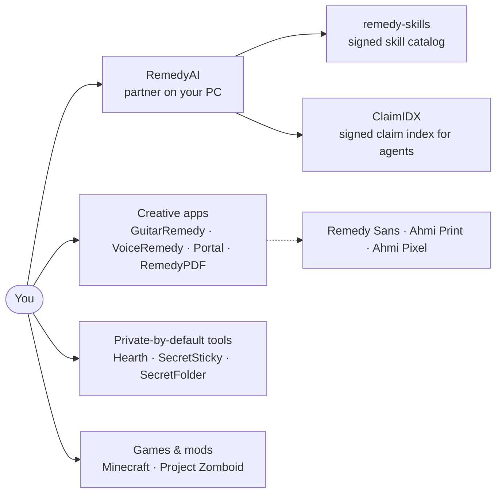

  

<h1 align="center">Hi, I'm Ahmi</h1>

  I mostly make free software, games, music and more. 
  <a href="https://ahmi.claimidx.com"><strong>Portfolio &amp; devlog</strong></a> ·
  <a href="https://claimidx.com"><strong>ClaimIDX</strong></a> ·
  <a href="https://www.patreon.com/cw/AhmiDarrow"><strong>Patreon</strong></a>

---

## How it fits together

- **[RemedyAI](https://github.com/AhmiDarrow/RemedyAI)** is the hub: a desktop partner that finishes the goal you set, with your own model and a local home at `~/.remedy`.
- **[ClaimIDX](https://claimidx.com)** is prior art for AI agents: a public, signed index of failures other agents already solved. RemedyAI hosts it locally.
- The **apps** each do one job well, offline-first, and share one look and one set of typefaces.

## Projects

| Project | What it is | Get it |
| --- | --- | --- |
| [RemedyAI](https://github.com/AhmiDarrow/RemedyAI) | A partner on this computer: Windows, Linux, macOS, plus a CLI |  |
| [ClaimIDX](https://github.com/claimidx/claimidx) | Signed claim index of agent failures and their fixes | [claimidx.com](https://claimidx.com) |
| [remedy-skills](https://github.com/AhmiDarrow/remedy-skills) | Signed catalog of installable skills for RemedyAI | [catalog](https://github.com/AhmiDarrow/remedy-skills) |
| [Portal](https://github.com/AhmiDarrow/Portal) | Browser dashboard for Kodi video add-ons, with casting |  |
| [GuitarRemedy](https://github.com/AhmiDarrow/GuitarRemedy) | Learn guitar: scales, tabs, song → tabs, a lesson a day for a year |  |
| [VoiceRemedy](https://github.com/AhmiDarrow/VoiceRemedy) | Offline singing coach with guided lessons |  |
| [RemedyPDF](https://github.com/AhmiDarrow/RemedyPDF) | Viewer and editor for PDF, EPUB, XPS, CBZ, DOCX |  |
| [Hearth](https://github.com/AhmiDarrow/Hearth) | Local file sharing and PC-to-PC chat |  |
| [SecretSticky](https://github.com/AhmiDarrow/SecretSticky) · [SecretFolder](https://github.com/AhmiDarrow/SecretFolder) | Encrypted sticky notes and an encrypted folder vault | [notes](https://github.com/AhmiDarrow/SecretSticky/releases/latest) · [vault](https://github.com/AhmiDarrow/SecretFolder/releases/latest) |
| [Alex's Craft Calc](https://github.com/AhmiDarrow/Alexs-Craft-Calc) | Soap and candle calculator with a craft wiki |  |

**Typefaces:** [Remedy Sans](https://github.com/AhmiDarrow/RemedySans) · [Remedy Sans UI](https://github.com/AhmiDarrow/RemedySansUI) · [Ahmi Print](https://github.com/AhmiDarrow/AhmiPrint) · [Ahmi Pixel](https://github.com/AhmiDarrow/AhmiPixelFont)

**Games & mods:** [Chocobos Reborn](https://github.com/AhmiDarrow/Chocobos-Reborn) · [Shamanic Mounts](https://github.com/AhmiDarrow/Shamanic-Mounts) · [The Great Journey](https://github.com/AhmiDarrow/The-Great-Journey) · [Ninjacat Skies](https://github.com/AhmiDarrow/Ninjacat-Skies) · [Tribal Power](https://github.com/AhmiDarrow/Tribal-Power)

<em>Hope this helps!</em>

